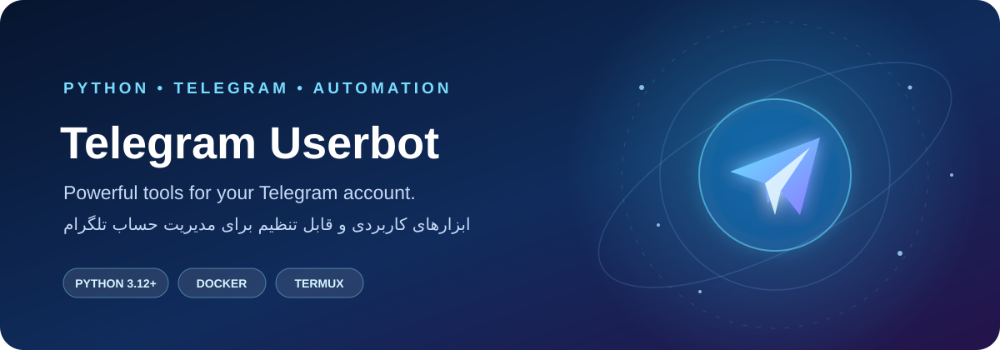

<div align="center">
  
  <br>
  <a href="https://github.com/MrSudoXS"></a>
  <h1>🤖 Telegram Userbot</h1>
  <p><strong>A Python selfbot for managing and automating your own Telegram account.</strong></p>
  <p>یک سلف‌بات پایتونی برای مدیریت و خودکارسازی حساب شخصی تلگرام؛ شامل ابزارهای مدیریتی و تنظیمات قابل‌پیکربندی.</p>
  <p>
    
    
    
  </p>
  <p><a href="https://github.com/MrSudoXS/telegram-bot">Repository</a> · <a href="https://github.com/MrSudoXS">Maintainer: @MrSudoXS</a></p>
</div>

---

## معرفی | About

این پروژه یک **Telegram Userbot (سلف‌بات)** است؛ یعنی با API حساب کاربری تلگرام اجرا می‌شود، نه با توکن یک ربات معمولی. ابزارهای آن برای مدیریت حساب خودتان، مدیریت پیام‌ها و گروه‌ها، راهنمای دستورات و تنظیمات شخصی طراحی شده‌اند. این پروژه ابزار حمله نیست؛ از قابلیت‌ها با رعایت قوانین تلگرام و احترام به حریم خصوصی دیگران استفاده کنید.

## امکانات | Features

- دستورات کاربردی و راهنمای داخلی (`.راهنما`)
- ابزارهای مدیریت پیام‌ها و برخی قابلیت‌های مدیریتی مانند Mute و Ban
- مدیریت Sessionهای ورود و ذخیره‌سازی اطلاعات
- تنظیمات از طریق فایل `.env`
- اجرا روی Linux، Windows و Termux؛ پشتیبانی از Docker و Docker Compose

## پیش‌نیازها

- Python 3.12 یا بالاتر، Git و pip (یا Docker و Docker Compose)
- `API_ID` و `API_HASH` از [my.telegram.org](https://my.telegram.org)

## نصب و اجرا | Quick start

```bash
git clone https://github.com/MrSudoXS/telegram-bot.git
cd telegram-bot
python -m venv .venv
```

فعال‌کردن محیط مجازی:

```bash
# Linux / Termux
source .venv/bin/activate

# Windows PowerShell
.\.venv\Scripts\Activate.ps1
```

نصب وابستگی‌ها و آماده‌سازی تنظیمات:

```bash
python -m pip install --upgrade pip
python -m pip install -r requirements.txt
cp .env.example .env
```

در Windows به‌جای `cp .env.example .env` از `Copy-Item .env.example .env` استفاده کنید. سپس مقادیر API خودتان را در `.env` تنظیم و برنامه را اجرا کنید:

```bash
python main.py
```

### اجرا با Docker

```bash
cp .env.example .env
# مقادیر لازم را در .env وارد کنید
docker compose build
docker compose run --rm bot
```

پس از ورود اولیه و ساخت Session، در صورت نیاز `SESSION_FILE` را در `.env` تنظیم و سرویس را اجرا کنید:

```bash
docker compose up -d
docker compose logs -f bot
```

## پیکربندی

فایل `.env` را از روی `.env.example` بسازید و مقادیر واقعی خود را وارد کنید:

```env
API_ID=your_api_id
API_HASH=your_api_hash
HELP_BOT_TOKEN=
SESSION_DIR=sessions
SESSION_FILE=
```

`HELP_BOT_TOKEN` اختیاری است. API ID و API Hash را از [my.telegram.org](https://my.telegram.org) بگیرید. در اولین اجرا، مراحل ورود را در ترمینال کامل کنید.

## امنیت

- هرگز `.env`، `API_HASH`، توکن ربات راهنما یا فایل‌های Session را منتشر نکنید.
- Session دسترسی حساب شما را می‌دهد؛ آن را محرمانه نگه دارید و برای لغو دسترسی از بخش **Devices** تلگرام استفاده کنید.
- فقط فایل `.env.example` را در مخزن نگه دارید و قوانین تلگرام را رعایت کنید.

## ساختار پروژه

```text
commands/   دستورات و ثبت آن‌ها
handlers/   پردازش پیام‌ها و ربات راهنما
utils/      ابزارها، فیلترها و ذخیره‌سازی
main.py     نقطه شروع برنامه
config.py   تنظیمات
```

## مشارکت و مجوز

برای گزارش مشکل یا پیشنهاد بهبود، در همین مخزن Issue بسازید یا Pull Request بفرستید. وضعیت مجوز را طبق فایل `LICENSE` مخزن بررسی کنید؛ اگر فایل مجوزی موجود نباشد، شرایط بازاستفاده مشخص نشده است.

---

<div align="center"><sub>Made with ❤️ and Python · <a href="https://github.com/MrSudoXS">MrSudoXS</a></sub></div>
